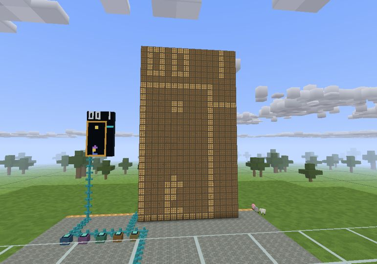
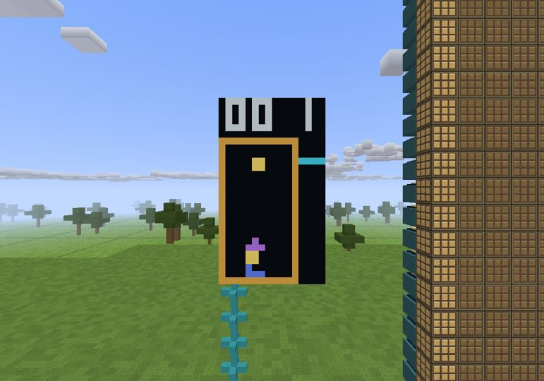

# V6.9 — Block Drop and modular pixel displays

A playable falling-block arcade built from connected in-world hardware. The game is an editable assembly program in a ROM block; the interpreter contains no falling-block game rules.

## Play

1. Install **Blockcraft V6.9** (full Windows game, or patch over an existing installation).
2. Extract **Blockcraft-Block-Drop-World.zip** and run `Install-world.bat`. It refuses to overwrite an existing save.
3. Open **Block Drop - Lamp Arcade and Modular Displays** in Singleplayer. Use view distance 5+.
4. Empty-hand right-click the keypad immediately to your left, then press **Enter**.

**Arrows** move/rotate, **Down** soft-drops, **Space** hard-drops, **P** pauses, **Enter/R** restarts, **Escape** releases the controls. The mouse can still look around. Leaving the keypad does not pause execution.

The world starts paused, with an empty board. The installer targets `%USERPROFILE%\.blockcraft112\saves\Block_Drop_V69`. Do not open the new world in an older game version.

## Actual game captures

These are captures of the Windows executable under Mesa software OpenGL, not mockups or generated illustrations.





## Build a bigger screen

- Each **Display Panel** adds **4×4 independent color pixels**.
- Put panels edge-to-edge, coplanar and facing the same direction. Complete rectangles work best.
- The supplied 4×7-panel wall is **16×28 pixels**. A fifth column makes it **20×28**.
- The framebuffer supports up to **64×64 pixels**. Attached walls mirror it, clipped to their individual dimensions.
- More panels provide more addressable pixels; they do not automatically stretch the existing game. Programs can query the canvas dimensions.
- The second screen uses **448 ordinary redstone lamps**, each powered by a directional pixel driver. It has normal lamp switch-off afterglow; the color screen is immediate.

## Real modules, editable code

Processor, ROM, 4K-word RAM, graphics coprocessor, keypad, data cable, lamp adapter and pixel drivers are reusable blocks in the creative inventory, with survival recipes. Exactly one processor, ROM, RAM and GPU must be connected. Cutting a required cable stops the processor; screens retain their last frame. Repairing the cable resumes execution.

`/arcade` builds another complete example in Creative without replacing existing blocks. `/computer` and the V6.8 four-bit circuit blocks are unchanged.

Look at a ROM and use `/rasterload FallingBlocks.asm` or `/rasterload Pattern.asm`. Missing examples are exported to `.blockcraft112/computer-programs/` without overwriting edits. The CPU supports arithmetic, branches, calls, RAM, keyboard and ordinary redstone IO, plus generic graphics/grid operations. Custom code has no filesystem, networking or OS access.

See [Raster-guide.txt](../../package/Raster-guide.txt) for all instructions, memory layout conventions, coordinates, recipes and limits. [FallingBlocks.asm](../../package/FallingBlocks.asm) is the **actual program installed in the world**. The whole save folder, including `raster.dat`, must be backed up.

## Scope

Seven tetrominoes, simple horizontal rotation kicks, a 10×20 board, next piece, line clearing, increasing gravity, score, pause/restart and game over. This is an original Tetris-style game, not official Tetris rules: no hold, ghost, seven-bag randomizer, SRS, T-spin scoring or lock delay.

Only the multiplayer host executes the processor and imports programs; controls and display output are replicated. Multiple keypads share control. Keep the host near the circuit so its chunks stay loaded. Networking remains Blockcraft's existing prototype, not a secured public server protocol.

## Reproduce verification

```sh
python3 tools/runtests.py
python3 tools/build.py --patch
python3 tools/verify_release.py releases/Blockcraft-UPDATE6.9-patch.zip 6.9
# Compile tools/worlds/BuildRasterWorld.java against build/classes and lwjgl-bundle.jar,
# then run bc.BuildRasterWorld with a NEW output world directory.
python3 tools/worlds/pack_raster_world.py
```

Focused tests cover the ROM game rules, bounded CPU execution, GPIO, real lamp states, all four panel orientations, added resolution, multiple keypads, duplicate modules, broken buses, save/resume, actual packet parsing, host authority and safe ROM importing. The native-world generator reloads and verifies the saved chunks and `raster.dat` rather than only inspecting its construction plan.
