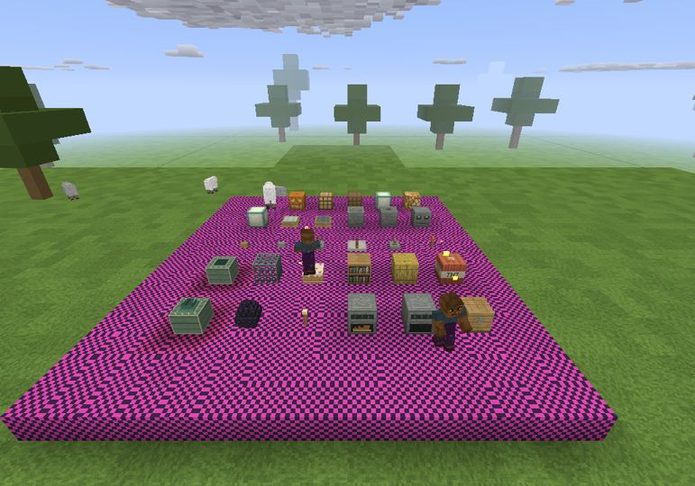
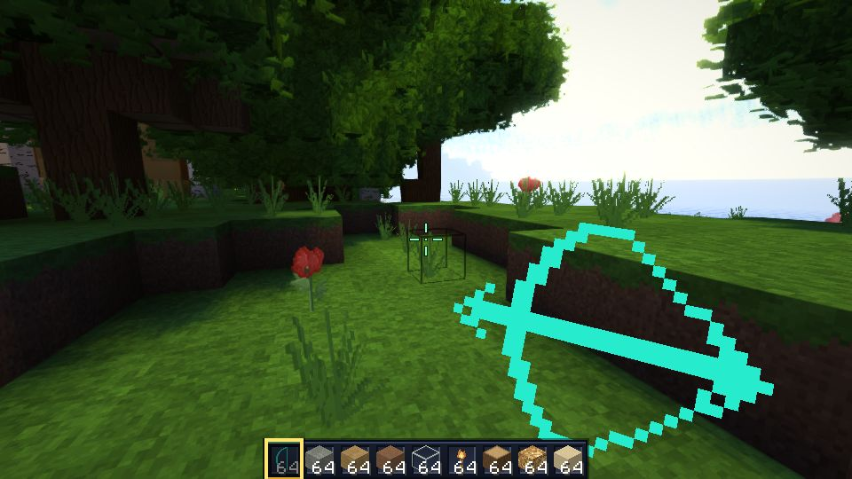
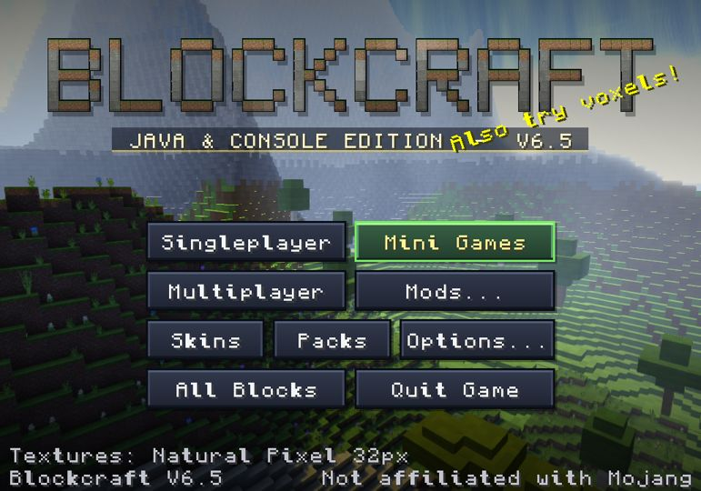

# V6.6 — reviewed art batches and Aseprite editing

[GitHub release](https://github.com/Aaron-1992/Blockcraft/releases/tag/v6.6) · [Editing guide](../../package/Texture-editing.txt)

## Player workflow

Run `Edit-textures.bat` next to `Blockcraft.exe`. This safely exports
`resourcepacks/MyTextures/` and opens the searchable `index.html`.
Edit a PNG in Aseprite, save/export to the same PNG, and use
**Options → Resource Packs → Reload PNGs**. Select **My Aseprite Textures**
the first time. Existing edits are never overwritten by the exporter.

The optional `Blockcraft-V6.6-Aseprite-textures.zip` contains the same starter
pack, ready to extract beside the EXE. It contains **532 individual 32×32 tiles
and six horizontal animation sheets**: water, lava, fire, portal, lit furnace
and eight bow poses. The PNG names contain actual atlas IDs; the searchable
index and TSV map faces, items and model components. The reference atlas is
not loaded, avoiding conflicts with individual edits. The white shader helper
is excluded, not artwork. Entity skins, sky and UI/font art are separate systems.

Native packs opt in with `tileSize=32`. They retain full-resolution pixels and
alpha, native item extrusion, and default fallbacks for missing files. Old
16px packs keep their rendering mode. Folder and ZIP packs both support the
new images. Static tile overrides deliberately take precedence over sheets;
malformed sizes are rejected, not cropped. Reload invalidates atlas, held-item,
bow and world/LOD caches. Pack changes never modify Java source or built-in art.

## Included review work

Includes the previously unreleased Building, Colors/Nature and Utility/Tools
batches, including chest lids, observers, folded banners and local emission.
See the [detailed review record](../art-review/utility-tools-review.md).
The user's publication request authorizes this release; it is not a claim of
blanket artistic approval. Planks, cobble, accepted stone bricks, shears and
flint-and-steel remain; flat bow mechanics, gun poses and held lighting stay.

## Verification

Production source: `88499ba9ba215b8bc4583a0aefb985d599824a22`.
Packaged source fingerprint:
`add6f4fa66ea21226e1158528e7c167c7debc2ad324bcd3e1d04bf57fbb01899`.

- [CI](https://github.com/Aaron-1992/Blockcraft/actions/runs/38629152787):
  **4,422,280 passed, 0 failed**; equivalence 397 identical / 64 intentional /
  145 new. Shader syntax, full native coverage and release-verifier tests pass.
- The export/import test compares the entire native atlas pixel-for-pixel,
  all animation frames, folder and ZIP loading, native atlas loading, alpha,
  changed bottom-right pixels, transparent tiles, missing-file fallback,
  static-animation precedence, safe re-export, reload and legacy 16px behavior.
- [Windows packaged-game smoke](https://github.com/Aaron-1992/Blockcraft/actions/runs/38629153212):
  title, open chest, edited world tiles and edited held bow all exit 0 with
  screenshots. Uses the committed V6.6 patch over the bundled base kit, testing
  both the Launch4j EXE and its embedded game via bundled Java on Windows/Mesa.
- [Linux actual-game visual](https://github.com/Aaron-1992/Blockcraft/actions/runs/38629152869):
  both edited-pack scenes exit 0; inspected both captures, plus all four Windows
  captures. PNG changes occur at frame 90, after initial GPU upload, through
  the same reload method as the menu. The magenta checker floor and teal bow
  below are **test markers only**, not shipped default art.
- Full release assembly checks every replacement against the tested patch and
  every untouched file against the base kit. EXE and JAR class bytes/receipts
  match. Editor kit is exported from that verified packaged JAR, not separately
  compiled classes. Release supplies full SHA-256 checksums for all three ZIPs.

V6.5 is preserved; release automation now refuses to overwrite existing tags.
Actual Aseprite GUI actions and the batch shortcut's Explorer/browser opening
were not manually exercised in a desktop session. PNG export/import and the
packaged Windows renderer were tested; software-Mesa screenshots are not a
hardware-GPU performance benchmark. Back up MyTextures when moving installs.
