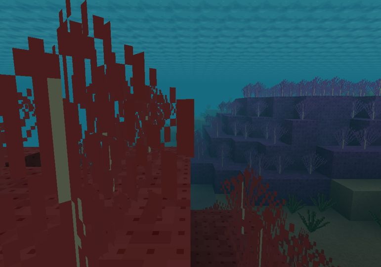
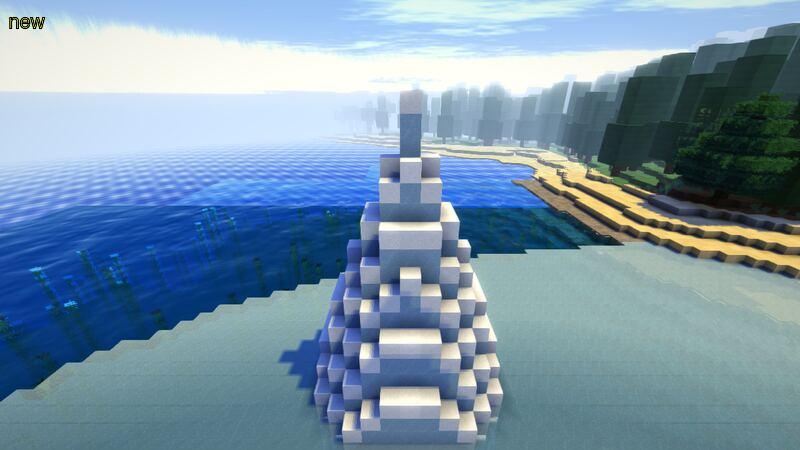
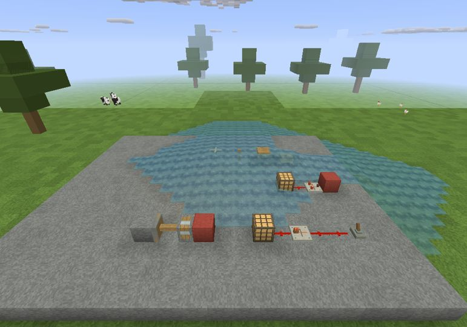
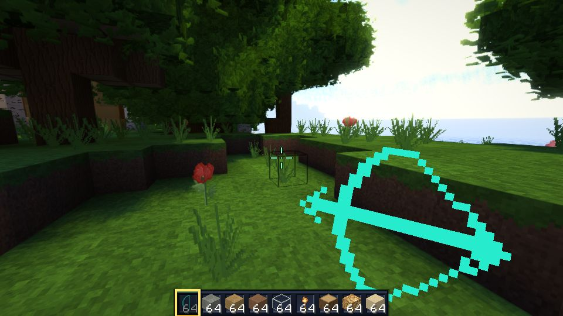

# V6.7 — aquatic worlds and Java-style redstone

[Release](https://github.com/Aaron-1992/Blockcraft/releases/tag/v6.7) ·
[Gameplay, controls and compatibility limits](../gameplay/aquatic-redstone.md) ·
[Aseprite guide](../../package/Texture-editing.txt)

## Included

- Temperature/depth-based oceans, underwater trenches, kelp, seagrass,
  five coral families/reefs and icebergs. Old saves retain their generator gate;
  create a new Default/Large/Amplified world to see the new terrain.
- Source/flow/falling water, nearest-drop routing, source renewal, currents,
  bubble-column forces, sprint swimming and saved waterlogging/bucket handling.
  Aquatic-era skylight attenuation and biome-specific underwater haze keep
  submerged reefs visible without repainting the water texture.
- Directional dust/conduction, timed repeaters with saved delays and side locks,
  comparators with inventory fullness and compare/subtract modes, timed torch
  inversion/burnout, six-facing observer pulses, lamp persistence and inverted
  analog daylight sensors. Slime-connected piston assemblies are validated
  atomically against the 12-block limit, with sticky short-pulse dropping.
- Unsigned saved/network block properties and host/client aquatic-generator
  synchronization. Circuit state belongs to each world, with load recovery.
- A real loading-screen stall found during visual testing is fixed: the mesh
  scheduler now visits all 16 vertical sections when nearby terrain exceeds
  Y=127. Missing/timed-out visual captures now fail verification, and timed-out
  Linux captures terminate their entire game/Xvfb process tree.

**Not complete Minecraft Java parity:** pistons remain instantaneous, without
moving-block entities or slime entity launches. Exact update-order/BUD/zero-tick
contraptions, the complete hopper/dispenser/dropper catalog, saved event
deadlines, note tuning persistence and the full aquatic mob/structure/growth
catalog are not implemented. Non-slab water surfaces use simplified clipping.
See the gameplay document for the precise scope. Back up saves, use V6.7 on all
peers, and do not downgrade worlds containing the new blocks/properties.

Existing artwork, flat sprite bow, corrected held lighting/gun poses and the
Aseprite workflow remain. New aquatic artwork uses only cells **781–793**.
The kit contains **545 static PNGs + six animation sheets**. Existing
`MyTextures` is never overwritten; missing new tiles fall back to defaults.
Publication/test results are not a claim of blanket artistic approval.

## Verification

Production source: `fb17f9e64640baf412a2768212125e5f167b0316`.
Packaged source fingerprint:
`ee05c4c33002ce96bfbca4a358c5fc85aedd1b38cad457e18c79baf585dcbe8e`.

- [CI](https://github.com/Aaron-1992/Blockcraft/actions/runs/38657850994):
  **4,423,150 passed, 0 failed**, also reproduced locally. Strict historical
  equivalence passes; 397 fingerprints identical / 64 intentional / 145 new.
  Historical fluid checks explicitly use legacy behavior; the new defaults
  have their own water/circuit/save/network/renderer regression tests.
- All shader syntax checks, native atlas coverage and five release-verifier
  tests pass. Existing art guards remain, excluding only the 13 new cells.
- [Windows smoke](https://github.com/Aaron-1992/Blockcraft/actions/runs/38657850982):
  the exact committed V6.7 EXE/JAR patch over the bundled base kit, on Windows
  with Mesa 26.2.4/llvmpipe. Title, underwater reef, circuit/waterlogging bench
  and edited flat bow all exit 0 and produce inspected screenshots.
- [Linux actual-game visual](https://github.com/Aaron-1992/Blockcraft/actions/runs/38657850960):
  reef, iceberg field, circuit bench and edited bow all exit 0 with captures.
  These are real generated terrain/model/render paths, not concept images.
- Full ZIP assembly checks all replacements against the tested patch and
  untouched files against the base kit. EXE and JAR receipts/classes agree.
  The texture kit is exported from that verified packaged JAR. Both copies of
  the editing guide are tested for equality. No source-only delivery.

Software-Mesa screenshots are not a hardware-GPU performance benchmark or
exhaustive multiplayer/conformance testing. The cyan bow below is an
intentional PNG reload test marker, **not shipped default artwork**.

## Verified assembled downloads

| Download | Bytes | SHA-256 |
|---|---:|---|
| [Blockcraft-V6.7-windows.zip](https://github.com/Aaron-1992/Blockcraft/releases/download/v6.7/Blockcraft-V6.7-windows.zip) | 82,306,884 | `3df56eec4b86b010e083591589ae014f298ae5767ffe2a697ee2abcc5f0fd16a` |
| [Blockcraft-V6.7-patch.zip](https://github.com/Aaron-1992/Blockcraft/releases/download/v6.7/Blockcraft-V6.7-patch.zip) | 33,457,846 | `fc1f759a3dc2eb0dbab730bee55ac1dc2a4d38a844ac17fc57dce6bdb4f191f7` |
| [Blockcraft-V6.7-Aseprite-textures.zip](https://github.com/Aaron-1992/Blockcraft/releases/download/v6.7/Blockcraft-V6.7-Aseprite-textures.zip) | 797,485 | `53f816689e678bce1e7c66f952fe1d271a5bba3b8b0ca65ce54ee15c58d2137a` |

V6.6's committed patch and published tag, assets, hashes and timestamps are
unchanged. The release workflow refuses to overwrite existing releases.

## Publication receipt

Published **2026-10-15T00:11:48Z** as a normal, non-prerelease GitHub release,
tag `v6.7` targeting `34a65eab04e1dc95b79fd63e2454d5eb4e5bc8c7`.
The GitHub latest-release endpoint confirms V6.7.

[Release workflow](https://github.com/Aaron-1992/Blockcraft/actions/runs/38658541940)
and [release-commit CI](https://github.com/Aaron-1992/Blockcraft/actions/runs/38658541971)
both succeeded. Final CI again reports **4,423,150 passed / 0 failed**.

GitHub-reported byte counts and SHA-256 digests for all four uploaded assets
match the locally assembled, verified files exactly:

- Full Windows ZIP: asset **642103944** (hash/size in the table above).
- Patch ZIP: asset **642103941**.
- Aseprite kit ZIP: asset **642103940**.
- `SHA256SUMS.txt`: asset **642103942**, **290 bytes**, SHA-256
  `0a8a353c08813f7281a98640cb775b5f93c6dcf4dc45d16ad32a3f98325fbaaa`.

V6.6's target, publication time, asset IDs, sizes, SHA-256 digests and asset
update timestamps were compared before and after publication and are identical.
Its committed patch is also unchanged from the pre-task checkout.
