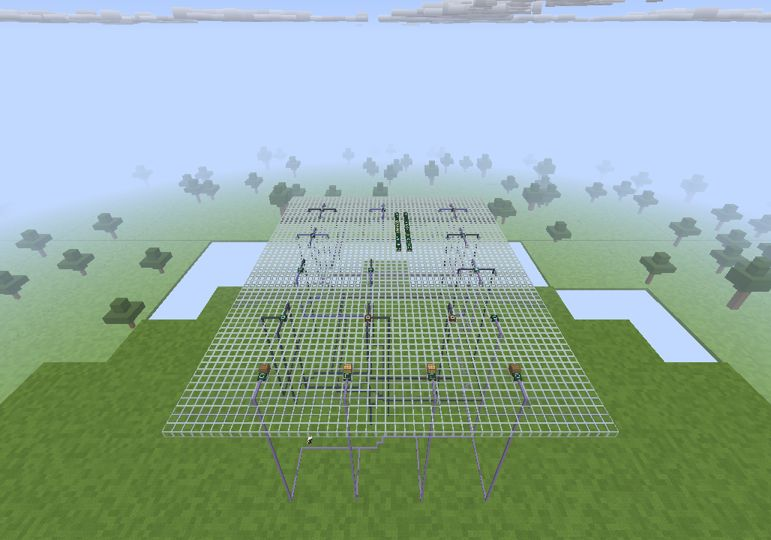
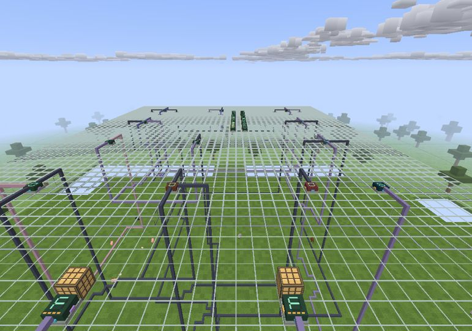
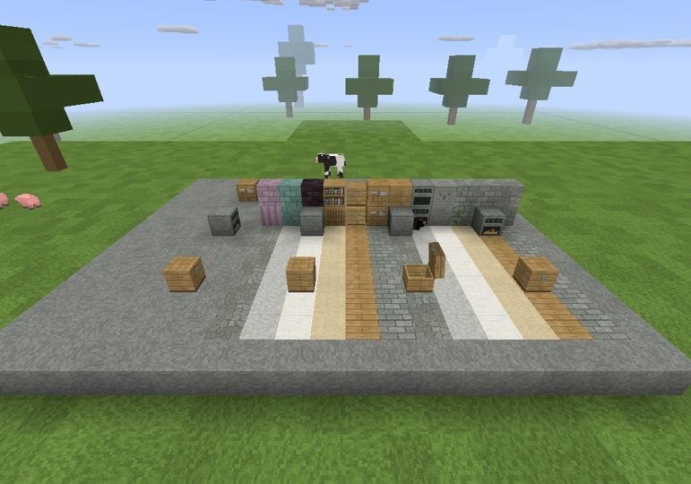

# V6.8 — buildable redstone computer and furniture facing

[Release](https://github.com/Aaron-1992/Blockcraft/releases/tag/v6.8) ·
[Computer guide](../../package/Computer-guide.txt) ·
[Aseprite guide](../../package/Texture-editing.txt)

## Playing

In a Creative world, let nearby chunks load, then type `/computer`.
The command builds a physical 47×61-block circuit platform above clear terrain,
without replacing existing blocks, and moves the player to a flying viewpoint.
Use view distance 5 or higher. Fly down to the orange clock:

- **Right-click:** Run/Stop.
- **Empty-hand sneak/right-click:** queue one Step while stopped.
- **Red reset button:** clear PC, accumulator and output, retaining the ROM.

The default program counts `1..F,0`. Instructions take about two seconds;
a counter increment takes three instructions. `Computer-guide.txt`, included
in both game downloads, explains the board map, opcodes, ROM editing, recipes
and ports. Aim at a circuit block for its live value and control hints.

## Included and limits

- Sixteen reusable, craftable components plus a three-dimensional 4-bit bus:
  constants, ALU, registers, physical 16-word ROM reader, PC selector, equality,
  AND/NOT/XOR/adder/multiplexer, clock, reset, hex display, bit outputs and a
  bridge from ordinary redstone. The example has **12 isolated, actually wired
  nets**, three registers, editable opcode/operand columns and four redstone lamps.
- `/computer` only places blocks; it never executes instructions. `Circuit`
  evaluates independent components and their actual connections. Editing ROM
  changes the program, and breaking the ALU's output wire changes the result.
- These are **custom redstone-compatible components**, not vanilla-only dust
  circuitry. Values and addresses are four bits; ROM holds 16 instructions.
  There is no terminal, operating system, keyboard or filesystem.
- ROM, register values, facing and settings use saved/networked raw block states.
  The host alone simulates circuits; remote Reset requests are transmitted states,
  not client-local timers. Clock phase restarts after reload and settling.
  Unloaded circuits do not run offline. A bus touching an unloaded chunk boundary
  conservatively pauses all computer clocks/registers in that world.
- Chests, loot chests, furnaces and crafting tables face the player on placement.
  Furnace ignition/extinguishing and chest fill/drain retain orientation;
  animated lids rotate after hinging, with unchanged UVs. Existing blocks keep
  their historical north orientation; re-place them to change it. Other existing
  directional block families retain their previous orientation systems.
- Actual elevated-view captures exposed a separate renderer bug: old, still-loaded
  meshes outside the real draw ring suppressed their LOD replacement, leaving
  sky holes in the ground. Coverage now checks the draw ring; repeat captures
  confirm those gaps are gone.

Existing artwork, flat sprite bow, held lighting and texture editing remain.
No art acceptance is inferred from functional tests. New chips reuse existing
utility textures plus geometric digits/colored ports; the latter are not PNGs.
The editor kit still exports **545 static tiles and six animation sheets**.
Back up saves, use V6.8 on every multiplayer peer, and do not downgrade worlds
containing the new IDs/properties. Wider redstone remains an original approximation,
not complete Minecraft Java parity; see the [V6.7 scope](../gameplay/aquatic-redstone.md).

## Verification

Production source commit: `105e075e21e76b93e47a4d7d118e62d56bb5af79`.
Source fingerprint: `5bf33ab00862882bb8f269994f97c398443b7419874eed92a1332a5b26b14205`.

- Local full suite and [GitHub CI 38664923731](https://github.com/Aaron-1992/Blockcraft/actions/runs/38664923731):
  **4,451,621 passed, 0 failed**. Equivalence: 397 unchanged fingerprints,
  64 intentional differences, 145 new. GLSL/package/native texture coverage passed.
- `TestsComputer`: **28,334 focused checks** covering exhaustive four-bit ALU
  input combinations, branches, the real assembled machine, changed programs/JZ/HALT, automatic
  wraparound, broken wiring, contention, actual `World.tick` lamp/dust interaction,
  save/load, partial unloading, multiplayer BLOCK parsing, furnace cooking and
  every oriented/animated chest vertex and UV.
- [Windows 38664923685](https://github.com/Aaron-1992/Blockcraft/actions/runs/38664923685):
  all five scenes exited 0 with captures, using the actual committed EXE through
  its Launch4j stub on Windows with software OpenGL. Title, two computer views,
  oriented/open furniture, and flat-bow PNG reload passed; GPU preferences present.
  Evidence commit: `cb9938a`.
- [Linux visual 38664923805](https://github.com/Aaron-1992/Blockcraft/actions/runs/38664923805):
  all five actual-game scenes captured successfully: computer overview/output,
  oriented chest open/closed, and bow PNG reload. Evidence commit: `8163c87`.
- Actual runtime logs record changing PC/accumulator/output values. The Windows
  close view advances its hex output through 0,1,2,3,4, rather than displaying a
  static test value. The cyan bow in reload evidence is an intentional edited PNG
  marker, **not** the shipped default artwork.
- EXE/JAR payload equality, source and relevant class hashes, packaged guide
  equality, both packaged `--build-info` paths, 330-file full-game assembly and
  all 551 editor PNGs verified before publication.

### Actual Windows captures

## Exact release assets

| Asset | Bytes | SHA-256 |
|---|---:|---|
| Blockcraft-V6.8-windows.zip | 82,361,244 | `3de5060e6be5a7c9e787c602e17443a9f3f6f59319fab5a67dca656cd88efd5f` |
| Blockcraft-V6.8-patch.zip | 33,512,206 | `7d3efcfb577dd0b9f1dbe89c77d190c9a9ffabf30ffbd2885e12a91f3e4864c7` |
| Blockcraft-V6.8-Aseprite-textures.zip | 798,659 | `f9cb3fcc5f4f5afface1afd2fdfce0116913b4b3f018d0009e9762c1429bb5e4` |
| SHA256SUMS.txt | 290 | `3b3d82bd6dea852e8d4a0d0e746527a0eb350b7d4a8e30b98b2a5be9cee4f3e3` |

## Publication receipt

Published **2026-10-15 01:26:32 UTC**, normal release (not a draft/prerelease),
tag `v6.8`, target `62a7aaad7eb07010e90a1004ed7edc621e1b96d3`.
The latest-release API confirms V6.8.

- [Release workflow 38665605188](https://github.com/Aaron-1992/Blockcraft/actions/runs/38665605188): **success**.
- [Release-target CI 38665605113](https://github.com/Aaron-1992/Blockcraft/actions/runs/38665605113): **success**, **4,451,621 passed / 0 failed**.
- All four uploaded asset sizes and GitHub SHA-256 digests match the exact
  locally assembled and verified files in the table above.
- Asset IDs: full game **642269495**, patch **642269498**, editor kit
  **642269500**, checksums **642269501**.
- V6.6 and V6.7 before/after release API snapshots compare identically for
  target commit, publication time, and every asset's ID, name, size, digest and
  update time. Their committed patch archives also remain byte-for-byte unchanged.

### Downloads

- [Full Windows game, bundled Java](https://github.com/Aaron-1992/Blockcraft/releases/download/v6.8/Blockcraft-V6.8-windows.zip)
- [Update patch](https://github.com/Aaron-1992/Blockcraft/releases/download/v6.8/Blockcraft-V6.8-patch.zip)
- [Optional Aseprite texture kit](https://github.com/Aaron-1992/Blockcraft/releases/download/v6.8/Blockcraft-V6.8-Aseprite-textures.zip)
